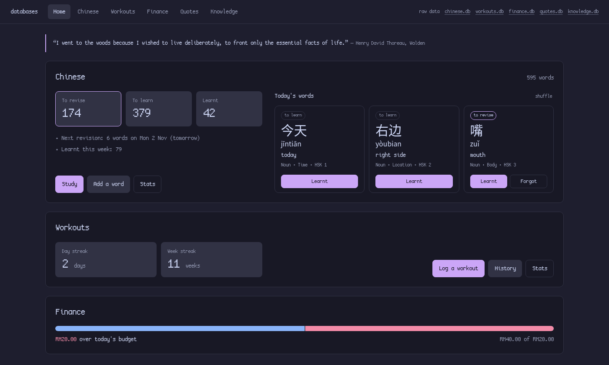
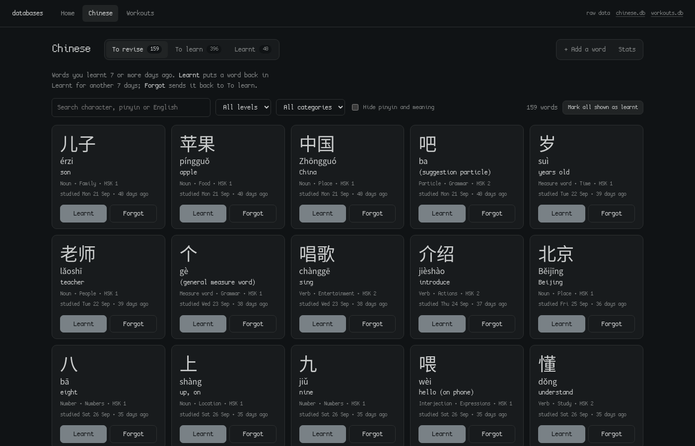
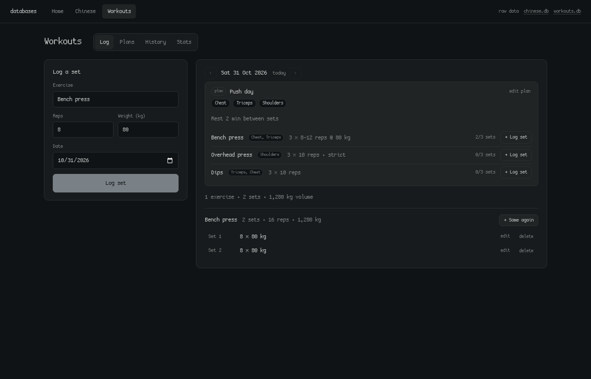
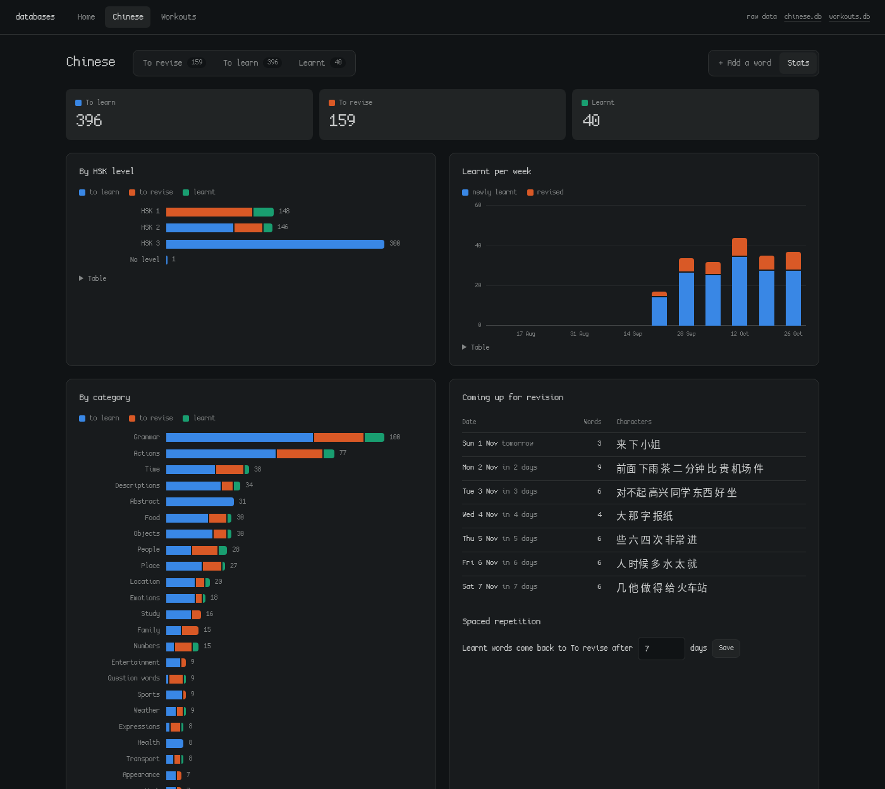
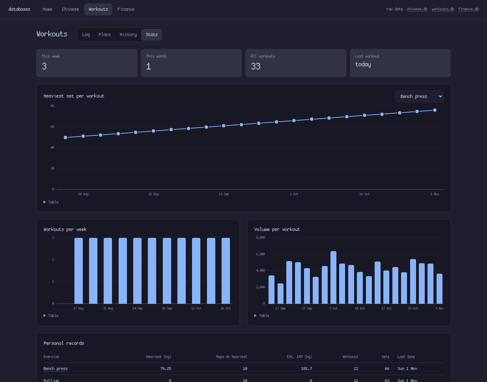
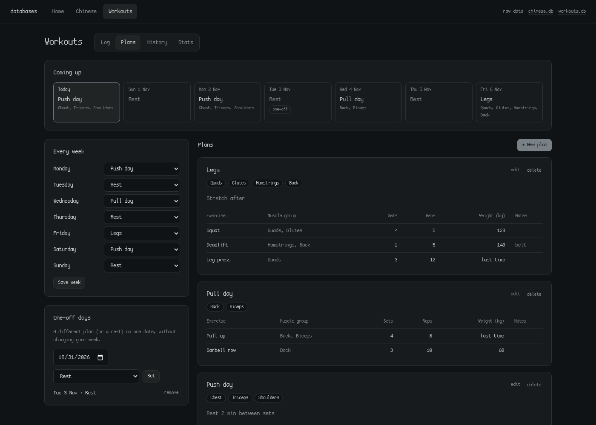

# _DATABASE

A small local web app for two personal trackers, each a SQLite database:

- **Chinese vocabulary** with three lists (to learn, to revise, learnt) and simple spaced repetition.
- **Workouts**, logged one set at a time, with streaks, progress charts and personal records.

It runs on your own computer at http://127.0.0.1:8001, built on [Datasette](https://datasette.io), and picks up your desktop theme's colours and font.



| Chinese | Workouts |
|---|---|
|  |  |
|  |  |
| |  |

## Requirements

| What | Why | Arch package |
|---|---|---|
| Linux with a desktop | tested on Arch Linux + Hyprland | |
| Python 3.11 or newer | runs the `db` command (standard library only) | `python` |
| SQLite 3.25 or newer | the databases | `sqlite` |
| [uv](https://docs.astral.sh/uv/) | installs Datasette | `uv` |
| Datasette **1.0a41** | serves the app; the 1.0 pre-release has the built-in add/edit/delete row buttons | installed with uv, see below |
| xdg-utils | `db` opens the browser with `xdg-open` | `xdg-utils` |
| A CJK font | Chinese characters and pinyin are shown in Noto Sans CJK SC | `noto-fonts-cjk` |
| Optional: fontconfig | the app's text uses your system monospace font (`fc-match monospace`) | `fontconfig` |
| Optional: libnotify | errors show as a notification when started from an app launcher | `libnotify` |

The colours come from the desktop theme file `~/.local/state/fuck-omarchy/current/theme/colors.toml` (the theme switcher of my [Omarchy](https://omarchy.org) fork). Without it the app uses a light default palette.

## Install

```bash
sudo pacman -S --needed python sqlite uv xdg-utils noto-fonts-cjk fontconfig libnotify
uv tool install --prerelease=allow 'datasette==1.0a41'

git clone https://github.com/l4n1skyy/local-database-web-app-for-personal-stuff.git _DATABASE
cd _DATABASE
ln -s "$PWD/bin/db" ~/.local/bin/db     # any folder on your PATH works
db                                       # creates the databases, starts the app, opens the browser
```

Clone it wherever you want your data to live: the databases and `backups/` are created inside this folder. The first run creates `chinese.db` and `workouts.db` from `schema/`. To load an existing vocabulary list, run `db import words.csv` (see [Importing words](#importing-words)).

To start it from an app launcher, save this as `~/.local/share/applications/databases.desktop`:

```ini
[Desktop Entry]
Type=Application
Name=Databases
Comment=Chinese vocabulary and workouts
Exec=db open
Icon=libreoffice-database
Terminal=false
Categories=Utility;
```

If your launcher doesn't see `~/.local/bin`, put the full path to `bin/db` in `Exec=`.

## The `db` command

| Command | What it does |
|---|---|
| `db` or `db open` | Starts the app if it isn't running, makes the day's backup and opens the browser |
| `db status` | Shows whether the app is running and how many words are in each list |
| `db import FILE.csv` | Adds Chinese words from a CSV; words already in the database are skipped |
| `db sync` | Runs the spaced repetition by hand (the app already does it by itself) |
| `db backup` | Copies both databases into `backups/` now |
| `db restart` | Restarts the app without opening the browser (after changing `plugins/app.py`) |
| `db stop` | Stops the app |

The app runs in the background. Its log is `~/.local/state/db/datasette.log`.

## Using it

The top bar has **Home**, **Chinese** and **Workouts**. **chinese.db** and **workouts.db** on the right open Datasette's own pages, where you can browse every table, filter and sort, run SQL, export CSV, and add, edit or delete any row.

### Home

- **Chinese:** how many words are in each list, when the next revision is due, and **Today's words**. That's 2 random words from To learn and 1 from To revise, or a third from To learn when nothing is due. The pick stays the same all day. A word you mark is replaced and the others stay put, and **shuffle** draws three new ones.
- **Workouts:** your **day streak** and **week streak**: days, and Monday-to-Sunday weeks, in a row with at least one workout. A day or week with no workout yet doesn't break the streak until it's over.

### Chinese

Every word is in one of three lists:

```
To learn ──Learnt──▶ Learnt ──7 days later, automatically──▶ To revise ──Learnt──▶ Learnt ...
    ▲                                                            │
    └──────────────────────────Forgot────────────────────────────┘
```

- **To learn:** press **Learnt** on a word once you know it. It moves to Learnt straight away.
- **Learnt:** each card shows the day the word comes back. 7 days after you last studied it, it moves to **To revise** by itself.
- **To revise:** **Learnt** keeps the word for another 7 days and **Forgot** sends it back to To learn.

The move to To revise happens when the app starts, every 5 minutes, and whenever you open a page, so you never have to trigger it.

On each list you can:
- search by character, pinyin (tone marks optional) or English;
- filter by HSK level or category;
- tick **Hide pinyin and meaning** to test yourself (click a card to see the answer);
- use **Mark all shown as learnt**, for example after filtering to HSK 1.

The other tabs:
- **+ Add a word:** only the character is required, and type and category suggest what you've used before.
- **Stats:** words per list, per HSK level and per category, words learnt and revised per week, and what's coming up for revision. The 7 days can be changed at the bottom.

To fix a typo or delete a word, hover its card and click **edit**.

### Workouts

Each entry is one set: exercise, reps, weight in kg (0 means bodyweight) and date.

- **Log:** press **Log set** once per set. The form stays filled in for the next set, and picking an exercise fills in what you did last time. **+ Same again** logs another identical set. Sets of the same exercise on the same day are numbered, and one day is one workout. ‹ › steps through earlier workouts, and each set has **edit** and **delete**. When a plan is on that day, it's shown at the top with how many of each exercise's sets you've done. **+ Log set** next to an exercise logs one set of it as planned, and clicking its name puts it in the form so you can change the numbers first.
- **Plans:** plan your workouts ahead.
  - **+ New plan** makes a plan (say "Push day") with a list of exercises, each with a muscle group, target sets, reps (a number or a range like 8-12), weight and notes. Leave the weight empty to use whatever you lifted last time. **up**/**down** reorder the exercises, and **edit**/**delete** on a plan change it later.
  - **Muscle groups** belong to the exercise ("Chest", or "Chest, Triceps" for several), so they show in every plan with that exercise and fill in by themselves when you pick it again. Each plan lists the muscle groups it trains, and so do the days in Coming up and the plan on the Log tab.
  - **Every week** puts a plan on each weekday (or leaves it a rest day), repeating every week.
  - **One-off days** set a different plan, or a rest, on one date without changing your week; **Back to the weekly plan** undoes it.
  - **Coming up** shows the next 7 days, so you can see what's on which day.
- **History:** every workout with its exercises, sets, reps and volume (kg × reps).
- **Stats:** workouts this week and month; heaviest set per workout for any exercise (most reps for bodyweight exercises); workouts per week; volume per workout; and personal records with an estimated one-rep max (Epley formula).

Every chart has a **Table** link under it with the same numbers.

## Importing words

`db import FILE.csv` reads a UTF-8 CSV with a header row. Only a `character` column is required (`Hanzi`, `Chinese` or `Word` also work). The optional columns are `pinyin`, `english` (or `meaning`), `notes`, `type`, `category`, `hsk` (or `level`), `status` (`to learn`, `to revise` or `learnt`), `last studied` and `date added`. Any other column is skipped. A word whose character and pinyin are already in the database is skipped too.

```csv
Hanzi,Pinyin,English,Type,Category,Hsk
爱,ài,love,Verb,Emotions,1
菜,cài,"dish, vegetable",Noun,Food,1
```

## Your data

- The databases are `chinese.db` and `workouts.db` in this folder. They're plain SQLite: open them with `sqlite3 chinese.db`, or DB Browser for SQLite.
- `db` copies both into `backups/` once a day and keeps the last 14 of each. To restore one, run `db stop`, then copy `backups/chinese-YYYY-MM-DD.db` over `chinese.db`.
- `.gitignore` keeps the databases and backups out of git.
- Datasette only listens on 127.0.0.1, so nothing outside your computer can reach the app.

## How it's built

| Path | |
|---|---|
| `bin/db` | the command above |
| `schema/chinese.sql`, `schema/workouts.sql` | tables, views and triggers. `db` applies them on every run, so changes take effect by themselves |
| `schema/sync.sql` | the spaced repetition rule, shared by the app and `db sync` |
| `plugins/app.py` | the app: its pages, the automatic sync, the charts and the theme colours (a Datasette plugin) |
| `templates/app_*.html`, `static/app.css`, `static/app.js` | the pages, styles and browser code |
| `datasette.yaml`, `metadata.yaml` | settings and descriptions for Datasette's own pages |
| `docs/` | the screenshots above |

The tables:
- **`words`:** `status` is the list a word is in, `last_studied` is set whenever it changes list, and `hsk` is its HSK level.
- **`study_log`:** a row every time a word changes list; the weekly stats use it.
- **`settings`:** `revise_after_days` holds the 7 days.
- **`sets`:** one row per set. The views `set_log`, `workouts` and `records` add set numbers, one row per workout, and best results per exercise.
- **`plans`**, **`plan_exercises`**, **`plan_schedule`:** the plans, their exercises in order, and which plan is on which day. **`exercise_muscles`** holds each exercise's muscle group. A day is a weekday (`mon` ... `sun`, every week) or a date (a one-off that wins over its weekday); no plan means a rest day.

Datasette runs this folder in configuration-directory mode, so it loads every `*.db` here along with `plugins/`, `templates/`, `static/` and both YAML files.
