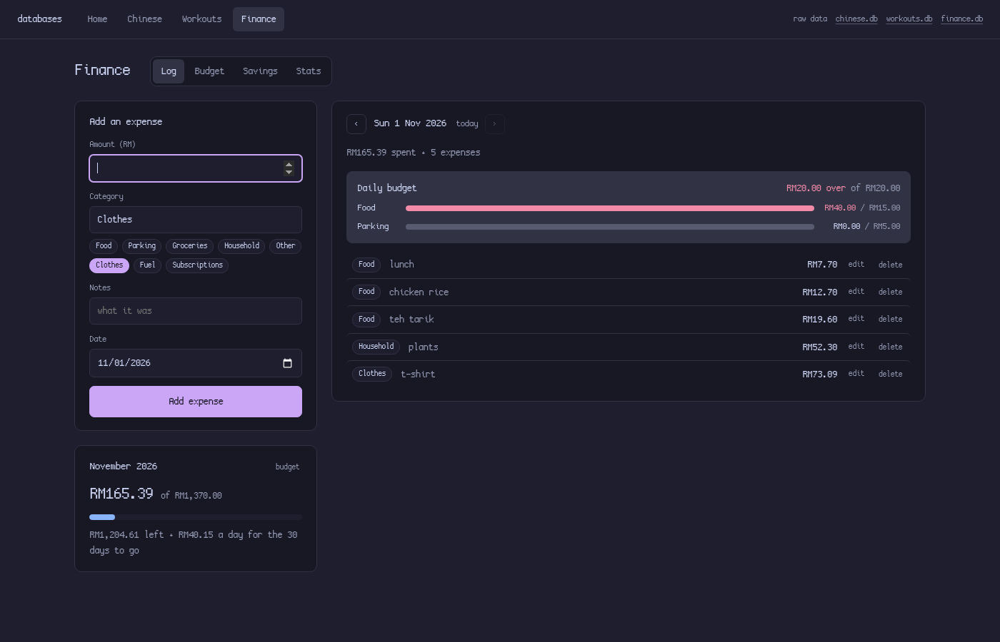
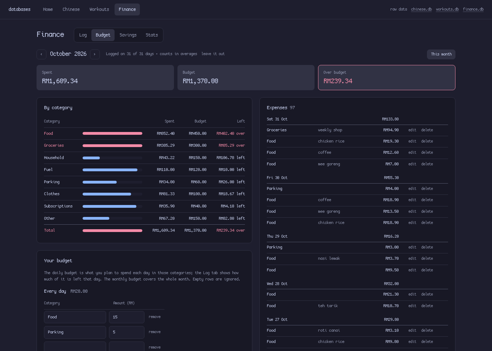
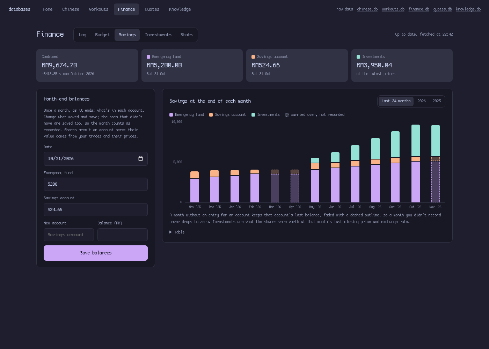
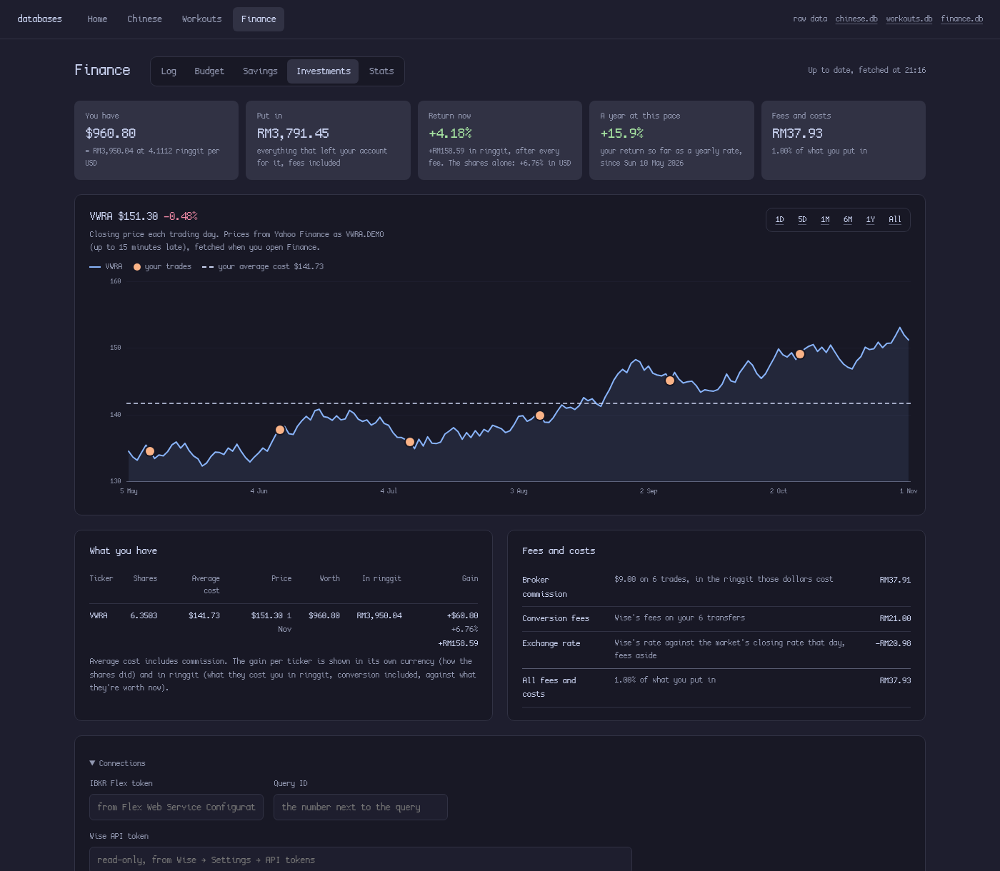
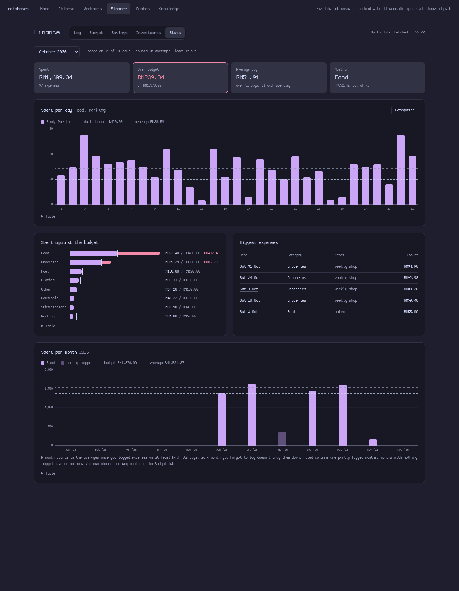
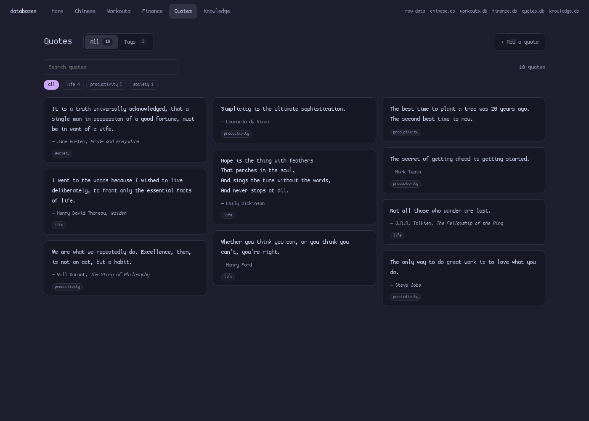
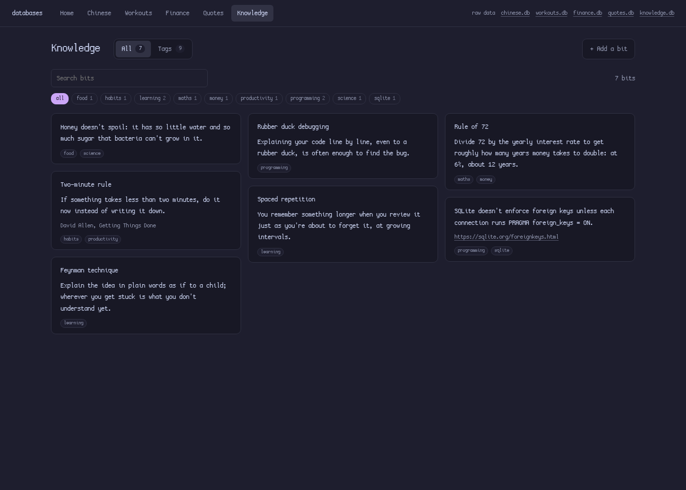

# _DATABASE

A small local web app for five personal trackers, each a SQLite database:

- **Chinese vocabulary** with three lists (to learn, to revise, learnt) and simple spaced repetition.
- **Workouts**, logged one set at a time, with streaks, progress charts and personal records.
- **Finance**: expenses against a daily and a monthly budget, savings balances and shares bought.
- **Quotes** and **Knowledge bits**: little notes worth keeping, with tags (one general tag per quote, any number per bit).

It runs on your own computer at http://127.0.0.1:8001, built on [Datasette](https://datasette.io), in [Catppuccin Mocha](https://catppuccin.com/palette) colours, with your system's monospace font.


| Chinese | Workouts | Finance |
|---|---|---|
|  |  |  |
|  |  |  |
| |  |  |
| | |  |
| | |  |

| Quotes | Knowledge |
|---|---|
|  |  |

## Requirements

| What | Why | Arch package |
|---|---|---|
| Linux with a desktop | tested on Arch Linux + Hyprland | |
| Python 3.11 or newer | runs the `db` command (standard library only) | `python` |
| SQLite 3.25 or newer | the databases | `sqlite` |
| [uv](https://docs.astral.sh/uv/) | installs Datasette | `uv` |
| Datasette **1.0a41** | serves the app; the 1.0 pre-release has the built-in add/edit/delete row buttons | installed with uv, see below |
| xdg-utils | `db` opens the browser with `xdg-open` | `xdg-utils` |
| A CJK font | Chinese characters and pinyin are shown in Noto Sans CJK SC | `noto-fonts-cjk` |
| Optional: fontconfig | the app's text uses your system monospace font (`fc-match monospace`) | `fontconfig` |
| Optional: libnotify | errors show as a notification when started from an app launcher | `libnotify` |

The colours are Catppuccin Mocha, set in `theme()` in `plugins/app.py`: change them there. Datasette's own pages get the same colours from `static/datasette.css`.

## Install

```bash
sudo pacman -S --needed python sqlite uv xdg-utils noto-fonts-cjk fontconfig libnotify
uv tool install --prerelease=allow 'datasette==1.0a41'

git clone https://github.com/l4n1skyy/local-database-web-app-for-personal-stuff.git _DATABASE
cd _DATABASE
ln -s "$PWD/bin/db" ~/.local/bin/db     # any folder on your PATH works
db                                       # creates the databases, starts the app, opens the browser
```

Clone it wherever you want your data to live: the databases and `backups/` are created inside this folder. The first run creates `chinese.db`, `workouts.db` and `finance.db` from `schema/`. To load an existing vocabulary list, run `db import words.csv` (see [Importing words](#importing-words)); finance data from Google Sheets goes in the same way (see [Importing finance data](#importing-finance-data)).

To start it from an app launcher, save this as `~/.local/share/applications/databases.desktop`:

```ini
[Desktop Entry]
Type=Application
Name=Databases
Comment=Chinese vocabulary, workouts and finance
Exec=db open
Icon=libreoffice-database
Terminal=false
Categories=Utility;
```

If your launcher doesn't see `~/.local/bin`, put the full path to `bin/db` in `Exec=`.

To have the app running whenever you're logged in (so a bookmark to `http://127.0.0.1:8001/` always works), run `db autostart` once. It writes and enables a systemd user service, `~/.config/systemd/user/db.service`; `db autostart off` removes it.

## The `db` command

| Command | What it does |
|---|---|
| `db` or `db open` | Starts the app if it isn't running, makes the day's backup and opens the browser |
| `db status` | Shows whether the app is running, how many words are in each list, your workouts, this month's spending, and how many quotes, bits and tags there are |
| `db import FILE` | Adds Chinese words from a CSV, or finance data (a Google Forms responses CSV or a budget TSV); rows already in the database are skipped |
| `db sync` | Runs the spaced repetition by hand (the app already does it by itself) |
| `db backup` | Copies the databases into `backups/` now |
| `db restart` | Restarts the app without opening the browser (after changing `plugins/app.py`) |
| `db stop` | Stops the app |
| `db autostart` | Starts the app whenever you log in, from now on (`db autostart off` undoes it) |

The app runs in the background, as the `db.service` user service once you've run `db autostart`. Its log is `~/.local/state/db/datasette.log`.

## Using it

The top bar has **Home**, **Chinese**, **Workouts**, **Finance**, **Quotes** and **Knowledge**. The **.db** links on the right open Datasette's own pages, where you can browse every table, filter and sort, run SQL, export CSV, and add, edit or delete any row.

### Home

- **At the top:** a quote of the day, on one thin line: one of your quotes, the same all day. Click it for all of them.
- **Chinese:** how many words are in each list, when the next revision is due, and **Today's words**. That's 2 random words from To learn and 1 from To revise, or a third from To learn when nothing is due. The pick stays the same all day. A word you mark is replaced and the others stay put, and **shuffle** draws three new ones.
- **Workouts:** your **day streak** and **week streak**: days, and Monday-to-Sunday weeks, in a row with at least one workout. A day or week with no workout yet doesn't break the streak until it's over.
- **Finance:** today's budget as a bar: the filled part is what you've spent, the rest what's left. Past the budget, the bar is everything spent and the part over the budget is red.

### Chinese

Every word is in one of three lists:

```
To learn ──Learnt──▶ Learnt ──7 days later, automatically──▶ To revise ──Learnt──▶ Learnt ...
    ▲                                                            │
    └──────────────────────────Forgot────────────────────────────┘
```

- **To learn:** press **Learnt** on a word once you know it. It moves to Learnt straight away.
- **Learnt:** each card shows the day the word comes back. 7 days after you last studied it, it moves to **To revise** by itself.
- **To revise:** **Learnt** keeps the word for another 7 days and **Forgot** sends it back to To learn.

The move to To revise happens when the app starts, every 5 minutes, and whenever you open a page, so you never have to trigger it.

On each list you can:
- search by character, pinyin (tone marks optional) or English;
- filter by HSK level or category;
- tick **Hide pinyin and meaning** to test yourself (click a card to see the answer);
- use **Mark all shown as learnt**, for example after filtering to HSK 1.

The other tabs:
- **+ Add a word:** only the character is required, and type and category suggest what you've used before.
- **Stats:** words per list, per HSK level and per category, words learnt and revised per week, and what's coming up for revision. The 7 days can be changed at the bottom.

To fix a typo or delete a word, hover its card and click **edit**.

### Workouts

Each entry is one set: exercise, reps, weight in kg (0 means bodyweight) and date.

- **Log:** press **Log set** once per set. The form stays filled in for the next set, and picking an exercise fills in what you did last time. **+ Same again** logs another identical set. Sets of the same exercise on the same day are numbered, and one day is one workout. ‹ › steps through earlier workouts, and each set has **edit** and **delete**. When a plan is on that day, it's shown at the top with how many of each exercise's sets you've done. **+ Log set** next to an exercise logs one set of it as planned, and clicking its name puts it in the form so you can change the numbers first.
- **Plans:** plan your workouts ahead.
  - **+ New plan** makes a plan (say "Push day") with a list of exercises, each with a muscle group, target sets, reps (a number or a range like 8-12), weight and notes. Leave the weight empty to use whatever you lifted last time. **up**/**down** reorder the exercises, and **edit**/**delete** on a plan change it later.
  - **Muscle groups** belong to the exercise ("Chest", or "Chest, Triceps" for several), so they show in every plan with that exercise and fill in by themselves when you pick it again. Each plan lists the muscle groups it trains, and so do the days in Coming up and the plan on the Log tab.
  - **Every week** puts a plan on each weekday (or leaves it a rest day), repeating every week.
  - **One-off days** set a different plan, or a rest, on one date without changing your week; **Back to the weekly plan** undoes it.
  - **Coming up** shows the next 7 days, so you can see what's on which day.
- **History:** every workout with its exercises, sets, reps and volume (kg × reps).
- **Stats:** workouts this week and month; heaviest set per workout for any exercise (most reps for bodyweight exercises); workouts per week; volume per workout; and personal records with an estimated one-rep max (Epley formula).

### Finance

Amounts are in ringgit (RM). Share prices are in US dollars.

- **Log:** add an expense: amount, category, notes and date. The buttons under the category field are the categories you use most. The day's expenses are listed on the right with **edit** and **delete**, and ‹ › step through earlier days. The **daily budget** shows how much of each daily category (say Food and Parking) you've spent that day, and the month's card shows how much of the monthly budget is left and what that comes to per day for the rest of the month.
- **Budget:** one month at a time (‹ › for others): spent, budget and what's left, per category with a bar that turns red once a category is over. Categories you spent on that aren't in the budget are listed too. The month's expenses are on the right, by day. **Your budget** at the bottom left sets the lines: **Every day** for the daily budget and **Every month** for the monthly one. Next to the month it says on how many days you logged something and whether the month counts in averages (see below).
- **Savings:** each entry is how much was in an account on a date, so the newest entry is the account's balance. Fill in **Month-end balances** once a month, as it ends (in the first week of a month the date already points at the end of the last one): every account is listed with its last balance, so you only change what moved, and the ones that didn't move are saved too. **New account** adds one. The tiles show each account's balance and the combined total with the change since the month before. The chart shows every month's end as a column, an account per segment and your shares on top: the last 24 months, or pick a year above it for its January to December. A month you didn't record an account keeps its last balance, faded with a dashed outline, so a lazy month never shows as zero.
- **Investments:** your shares, with nothing to type in: trades and deposits come from IBKR, what each deposit cost in ringgit from Wise, prices from Yahoo Finance. The tab is read-only.
  - **Connections** (at the bottom) takes the two tokens once. **IBKR** (Interactive Brokers): in the Client Portal, under Performance & Reports → Flex Queries, make an **Activity Flex Query** with the sections Trades, Cash Transactions, Open Positions and Cash Report (XML, date format `yyyyMMdd`, last 365 days), turn on **Flex Web Service** for a token, and paste the token and the query's number. **Wise**: under Settings → API tokens, make a **read-only** token and paste it. Wise only gives statements through its API to some countries' accounts (Malaysia's included). Both tokens only read, and are kept in `finance.db`, which stays out of git.
  - **When it fetches:** each time you open Finance (any tab), unless it already did in the last 5 minutes, and never in between: nothing runs on a timer. The page shows what it has straight away and says *Fetching prices, IBKR and Wise…*; once that's done (a few seconds, IBKR takes longest) the Investments tab swaps in the new numbers. When IBKR, Wise or Yahoo can't be reached it tries twice more, and if it still can't, opening Finance again tries again straight away. To stop fetching prices (the README's demo does), set `prices_auto` to `off` in the `settings` table.
  - **What it fetches and keeps:** from Yahoo Finance, the daily closing prices of each ticker and its currency's rate to ringgit, from a year before your first trade (saved in `prices`; a day's price is replaced by a newer one for the same day), and the 15-minute prices of the last five trading days (kept in memory only, for the 1D and 5D charts). From IBKR, the Flex statement: new trades go into `trades` (a trade the app already has isn't added again, but takes IBKR's date and commission) and deposits into `deposits`. From Wise, the statements of your ringgit and dollar balances: the payment behind each new IBKR deposit (same amount, sent up to a week before) becomes a conversion (the ringgit that left, fee included, and the fee), and conversions the app already has take Wise's date, ringgit and fee. Money sent from your dollar balance costs what its dollars cost you (the conversions into it, with their fees); dollars of unknown cost count at that day's market rate. Also from Wise, its price right now for changing your dollars back into ringgit (the public quote its own calculator uses, no token needed), kept in `settings` for the exit fees. The statements themselves aren't saved, and nothing is ever deleted: a trade that drops out of IBKR's 365 days stays.
  - The tiles: **You have** (what the shares and any unspent dollars are worth, in dollars and in ringgit), **Initial investment** (everything that left your account for them, every fee included), **Return now** (what you have against that, in ringgit after every fee), **Shares alone** (how the shares did in their own currency), **A year at this pace** (your money-weighted return as a yearly rate, XIRR) and **Fees and costs** (with their share of the initial investment).
  - **Fees and costs** splits them up: broker commission (in the ringgit those dollars cost), Wise's fees, and the exchange rate: Wise's rate against the market's closing rate that day, fees aside (it can be below zero when it beat it). Under them, **Estimated exit fees**: what selling everything today and bringing it back as ringgit would cost: IBKR's commission (as much as on your last trade), withdrawing (IBKR's first withdrawal each month is free) and Wise's fee for changing the dollars into ringgit, receiving IBKR's transfer included.
  - The price chart shows the ticker every 15 minutes for the last trading day (**1D**) or five (**5D**), or its daily closing price over **1M**, **6M**, **1Y** or since you bought (**All**), with your trades as dots and your average cost as a line. Yahoo's prices can be 15 minutes late.
  - **What you have** lists each ticker: shares, average cost (commission included), price, worth, and the gain in its own currency and in ringgit. Selling uses the average cost; the money stays as cash in that currency until it's changed back.
  - Problems show at the top of the tab, and only then: a fetch from IBKR or Wise that didn't work, or a deposit no Wise payment accounts for yet (it counts at that day's market rate until one does). The trades and transfers themselves are in `finance.db` (the **finance.db** link at the top).
  - On the Savings tab, the shares are a segment of each month's column: what they were worth at that month's last closing price and exchange rate.
  - Without IBKR, fees logged as expenses in the **Currency Exchange** category stand in for conversion fees; with conversions they're not counted again, since the fees are inside them.
- **Stats:** for any month, or all time. Spent per day for the categories you pick under **Categories** (the daily budget's until you pick some), with their daily budget and their average as lines; each category's spending against its budget, red past it; the biggest expenses; and spent per month, January to December, against the budget and the average month. This month also shows what it's on pace for. Averages per day count every day, the days you spent nothing too.

**Months you didn't log.** A month counts in averages (the average month, the average day of all time, the average line) once you logged expenses on at least half its days. A month you forgot is left out instead of counting as a cheap month: on the charts it's faded, or has no column at all when nothing was logged. The current month never counts, as it isn't over. If a month really was that cheap, or you want to leave a logged one out, **count it anyway** / **leave it out** next to the month on the Budget or Stats tab decides it (**back to automatic** undoes that).

Every chart has a **Table** link under it with the same numbers.

### Quotes and Knowledge

Two pages that work the same way: Quotes for quotes (the quote, who said it, where it's from, notes), Knowledge for knowledge bits (an optional title, what you learnt, and its source: a link, a book or a person).

- **All** shows them newest first, in columns. The search box filters as you type (text, author, source and tags), and the tags above the list show one tag at a time with how many it has. A tag on a card shows that tag too.
- **+ Add** takes the text, the other fields and its tags. A quote has one tag: pick it, or type a new one under **Or a new tag** (that one wins). A bit can have any number: tick the tags you have, and type new ones under **New tags**, separated by commas. Tags are lower case (`#Self Control` becomes `self control`). **edit** on a card (it shows on hover) changes everything about it, its tags included, and has **Delete** at the bottom.
- **Tags** lists every tag with how many notes it has. **Rename** renames it everywhere (renaming it to a tag that exists puts the two together), **delete** takes it off its notes (the notes stay), and **New tag** makes one before anything has it.

The quotes started as the Quotes note in Obsidian: each quote became a row, its attribution was split into who said it and where it's from, and each got one general tag: life, productivity or society (one that fits none of them has no tag).

## Importing words

`db import FILE.csv` reads a UTF-8 CSV with a header row. Only a `character` column is required (`Hanzi`, `Chinese` or `Word` also work). The optional columns are `pinyin`, `english` (or `meaning`), `notes`, `type`, `category`, `hsk` (or `level`), `status` (`to learn`, `to revise` or `learnt`), `last studied` and `date added`. Any other column is skipped. A word whose character and pinyin are already in the database is skipped too.

```csv
Hanzi,Pinyin,English,Type,Category,Hsk
爱,ài,love,Verb,Emotions,1
菜,cài,"dish, vegetable",Noun,Food,1
```

## Importing finance data

`db import` also reads the two sheets of a Google Sheets finance tracker; download each one as a file and import it:

- **The responses of a Google Form** (File > Download > CSV), with the columns `Timestamp`, `Transaction Type`, `Category`, `Account Type`, `Amount (MYR)`, `Notes`, `Ticker`, `Number of Shares`, `Price per Share (USD)` and `Commission (USD)`. `Expenses` rows become expenses. `Savings` rows become account balances, or share purchases when the account type is `Investment`. Amounts like `RM1,200.00` are fine, and dates are day/month/year. A row that's already in the database is skipped, so you can import a newer download of the same sheet and only the new rows are added.
- **A budget sheet** saved as TSV (File > Download > Tab-separated values): a header row with `Daily`, `Amount`, `Monthly`, `Amount`, then one category per row under each, down to its `Total` row. This replaces the whole budget.

```
	Daily	Amount	Monthly	Amount
	Food	RM10.00	Groceries	RM300.00
	Parking	RM4.00	Fuel	RM100.00
	Total	RM14.00	Total	RM400.00
```

## Your data

- The databases are `chinese.db`, `workouts.db`, `finance.db`, `quotes.db` and `knowledge.db` in this folder. They're plain SQLite: open them with `sqlite3 chinese.db`, or DB Browser for SQLite.
- `db` copies them into `backups/` once a day and keeps the last 14 of each. To restore one, run `db stop`, then copy `backups/chinese-YYYY-MM-DD.db` over `chinese.db`.
- `.gitignore` keeps the databases and backups out of git.
- Datasette only listens on 127.0.0.1, so nothing outside your computer can reach the app.

## How it's built

| Path | |
|---|---|
| `bin/db` | the command above |
| `schema/chinese.sql`, `schema/workouts.sql`, `schema/finance.sql`, `schema/quotes.sql`, `schema/knowledge.sql` | tables, views and triggers. `db` applies them on every run, so changes take effect by themselves |
| `schema/sync.sql` | the spaced repetition rule, shared by the app and `db sync` |
| `plugins/app.py` | the app: its pages, the automatic sync, the charts and the colours (a Datasette plugin) |
| `templates/app_*.html`, `static/app.css`, `static/app.js` | the pages, styles and browser code |
| `static/datasette.css` | Datasette's own pages in the same colours |
| `datasette.yaml`, `metadata.yaml` | settings and descriptions for Datasette's own pages |
| `docs/` | the screenshots above |

The tables:
- **`words`:** `status` is the list a word is in, `last_studied` is set whenever it changes list, and `hsk` is its HSK level.
- **`study_log`:** a row every time a word changes list; the weekly stats use it.
- **`settings`:** `revise_after_days` holds the 7 days.
- **`sets`:** one row per set. The views `set_log`, `workouts` and `records` add set numbers, one row per workout, and best results per exercise.
- **`plans`**, **`plan_exercises`**, **`plan_schedule`:** the plans, their exercises in order, and which plan is on which day. **`exercise_muscles`** holds each exercise's muscle group. A day is a weekday (`mon` ... `sun`, every week) or a date (a one-off that wins over its weekday); no plan means a rest day.
- **`expenses`:** one row per expense (date, category, amount in RM, notes).
- **`budget`:** one line per category and period (`daily` or `monthly`).
- **`balances`:** an account's balance on a date; the view `latest_balances` has each account's newest.
- **`month_settings`:** months you decided to count in averages, or leave out, yourself; without a row it's automatic. The view `months` has the days logged per month.
- **`daily_chart_categories`:** the categories Spent per day adds up; empty means the daily budget's.
- **`trades`:** shares bought and sold (price and commission in the share's currency), from IBKR. **`conversions`:** ringgit changed into another currency for shares, from Wise. **`tickers`:** each ticker's Yahoo Finance symbol and currency. **`prices`:** daily closing prices, and exchange rates as `USD/MYR`. The view `holdings` adds the trades up per ticker.
- The views `months` and `monthly_spending` total the expenses per month. **`settings`** remembers when prices were last fetched, which expense categories stand in for conversion fees (`fee_categories`), whether prices are fetched (`prices_auto`) and the IBKR and Wise connections (`ibkr_*`, `wise_*`). **`deposits`:** IBKR's deposits and withdrawals.

- **`quotes`** and **`bits`:** the notes. **`tags`:** every tag (one list per database). **`quote_tags`** and **`bit_tags`:** which note has which tag; a tag given here that isn't in `tags` yet is added to it, renaming a tag renames it here, and deleting a tag or a note removes its rows here. The views `quotes_tagged` and `bits_tagged` show each note with its tags, and `tag_counts` how many each tag has.

Datasette runs this folder in configuration-directory mode, so it loads every `*.db` here along with `plugins/`, `templates/`, `static/` and both YAML files.
